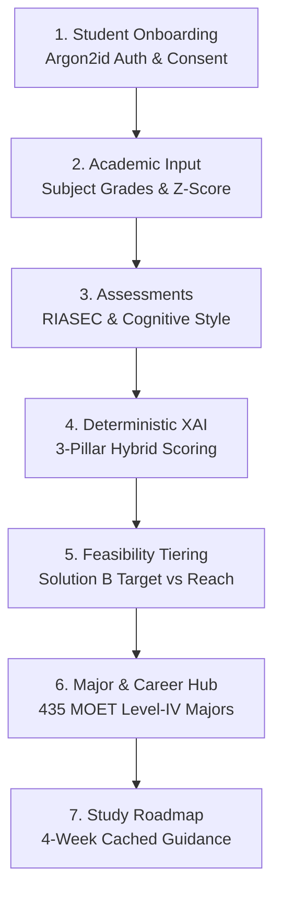
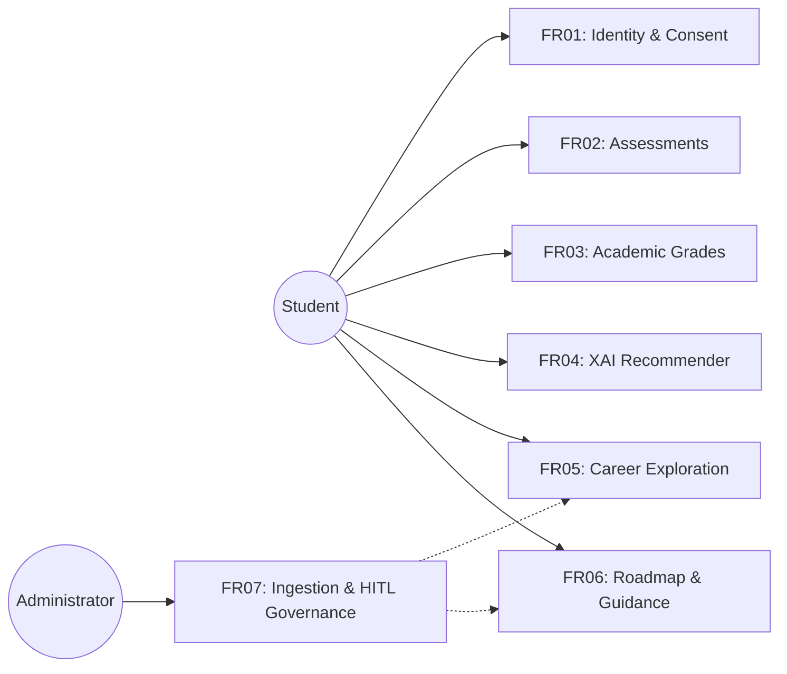
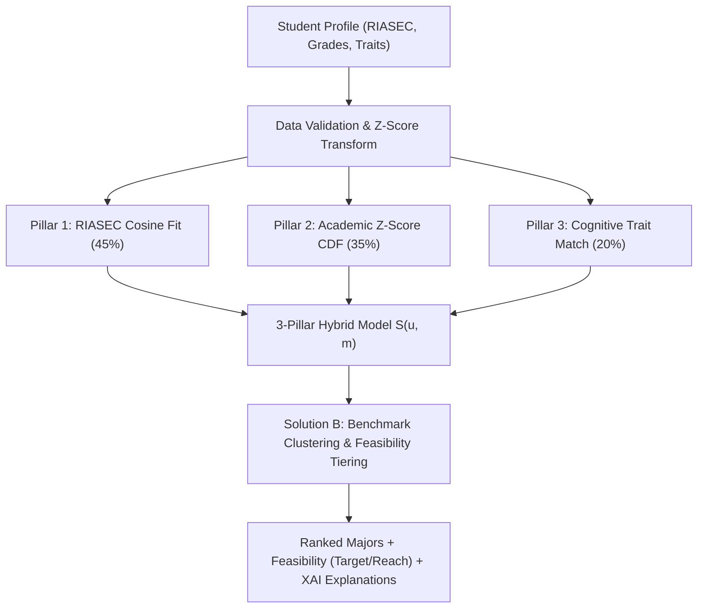
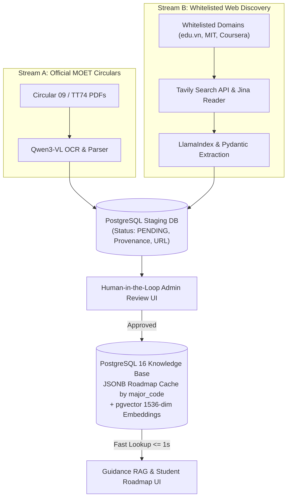
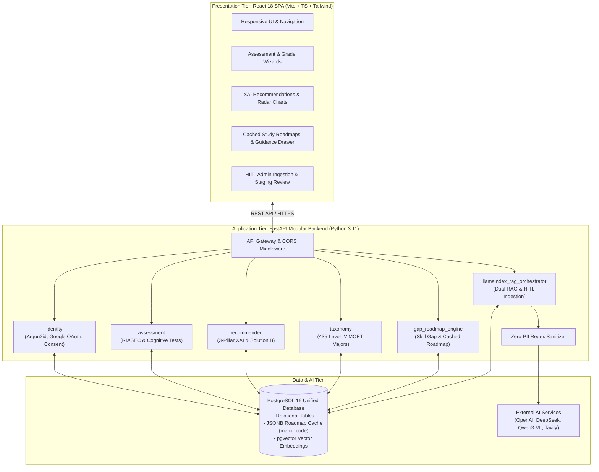

# CAPSTONE PROJECT PROPOSAL
## AI CAREERGUIDE: Personalized Major Guidance for Vietnamese High School Students

**DUY TAN UNIVERSITY – INTERNATIONAL SCHOOL**  
**Course Code:** CMU-SE 450 – Capstone Project 1 (Group C1SE.71)  
**Academic Unit:** Faculty of Information Technology / International School  
**Document Version:** Version 1.1  
**Date:** November 04, 2026  
**Location:** Da Nang, Vietnam  

---

### **PROJECT INFORMATION**

| Field | Information |
| :--- | :--- |
| **Project acronym** | AI CareerGuide |
| **Project title** | AI CareerGuide: Personalized Major Guidance for Vietnamese High School Students |
| **Project type** | Responsive web application, Explainable AI (XAI) decision-support system, grounded self-study guidance platform |
| **Proposed start date** | July 28, 2026 |
| **Proposed end date** | December 26, 2026 |
| **Lead institution** | International School, Duy Tan University |
| **Project mentor** | MSc. Son, Phan Van – sonpvs@duytan.edu.vn – 0905042413 |
| **Project leader** | Duy, Nguyen Tan – nguyentduy.025@gmail.com – 0396157802 |
| **Repository URL** | https://github.com/ntanduy25/AI-CAREERGUIDE.git |
| **Implementation window** | 15 Weeks (September 14, 2026 – December 26, 2026) |
| **Document baseline** | Proposal Version 1.1 (Comprehensive Project Alignment & Implementation Baseline) |

---

### **TEAM MEMBERS & ROLES**

| Student ID | Full Name | Email | Primary Project Role & Sprint Focus |
| :--- | :--- | :--- | :--- |
| **29211142148** | **Duy, Nguyen Tan** | nguyentduy.025@gmail.com | **Project Leader; Backend / Integration / DevOps** Project coordination, sprint backlogs, REST API gateway, Argon2id authentication, Google OAuth 2.0 integration, CI/CD pipeline, and cloud deployment orchestration. |
| **29212736855** | **Trung, Nguyen Tam** | tamtrung3666@gmail.com | **System Architect; Full-stack Developer** Software architecture, PostgreSQL 16 + `pgvector` schema design, Alembic async migrations, security enforcement, deterministic business logic, and backend micro-services. |
| **29214360592** | **Cuong, Nguyen Tu** | tucuong37k5@gmail.com | **Business Analyst; QA Engineer** Requirements specification, user story mapping, acceptance criteria, automated test suites (Pytest & Playwright), data verification, and security/privacy audit validation. |
| **29219030682** | **Hieu, Nguyen Thai Hoang** | nguyenthaihoanghieu3012005@gmail.com | **Frontend Developer; UI/UX Specialist** React 18 & TypeScript Single Page Application (SPA), Tailwind CSS, WCAG 2.1 AA accessibility compliance, responsive evaluation workflows, interactive career explorer, and guidance dashboards. |
| **29219065409** | **Hien, Nguyen Thanh Long** | hiennguyen05102005@gmail.com | **AI, Recommendation & Data Engineer** Mathematical 3-pillar XAI scoring engine (Cosine similarity, Z-score CDF, Cognitive trait rules), admission feasibility tiering, LlamaIndex Dual RAG, Tavily Search API, and Qwen3-VL OCR pipeline. |

---

### **DOCUMENT APPROVALS**

| Role | Name | Signature / Status | Date |
| :--- | :--- | :--- | :--- |
| **Academic Mentor** | MSc. Son, Phan Van | Approved | Nov 04, 2026 |
| **Project Leader** | Duy, Nguyen Tan | Signed | Nov 04, 2026 |
| **System Architect** | Trung, Nguyen Tam | Signed | Nov 04, 2026 |
| **Quality Assurance** | Cuong, Nguyen Tu | Signed | Nov 04, 2026 |
| **Frontend Lead** | Hieu, Nguyen Thai Hoang | Signed | Nov 04, 2026 |
| **AI & Data Lead** | Hien, Nguyen Thanh Long | Signed | Nov 04, 2026 |

---

### **REVISION HISTORY**

| Version | Date | Key Modifications / Architectural Evolution | Authors |
| :--- | :--- | :--- | :--- |
| **v1.0** | Aug 18, 2026 | Initial proposal draft and conceptual domain definitions. | C1SE.71 Team |
| **v1.1** | Nov 04, 2026 | **Comprehensive Project Alignment & Technical Evolution (Current Baseline):** 1. **Pure Guidance Scope:** Refined project scope to pure vocational career guidance, removing tuition and geographic filtering to completely eliminate socio-economic bias. 2. **Theoretical Grounding:** Grounded all evaluation modules in recognized psychological and educational frameworks (Holland RIASEC, Gardner's Multiple Intelligences, MBTI Cognitive Dimensions, Phoenix Ho Career Tree, Locke & Latham Goal-Setting). 3. **Mathematical 3-Pillar XAI Engine:** Formulated explicit, deterministic scoring algorithms (Cosine Similarity for RIASEC, National Z-Score Gaussian CDF for academic readiness, rule-based cognitive trait matching) ensuring $100\%$ determinism decoupled from LLMs. 4. **Admission Feasibility Tiering (Solution B):** Introduced dynamic academic clustering (High, Medium, Standard competition) and feasibility classification (Target vs. Reach) to provide realistic advice. 5. **Two-Stream Knowledge Ingestion & Dual RAG:** Established Stream A (MOET Circulars 09/2022 and 74/2026 with 435 Level-IV majors ingested via Qwen3-VL OCR) and Stream B (Tavily/Jina whitelisted web roadmap discovery with Human-in-the-Loop staging review). 6. **High-Efficiency Caching:** Implemented write-once/read-many study roadmap caching in PostgreSQL (`JSONB` + `pgvector`) indexed by `major_code` ($\le 1\text{s}$ retrieval latency), eliminating recurring AI token costs. 7. **Security & Zero PII Guardrails:** Upgraded security to OWASP ASVS Level 2 with Argon2id password hashing, Google OAuth 2.0 flow, and compliance with Vietnam Law No. 91/2025/QH15 on Personal Data Protection. 8. **Verification:** Verified complete system with 69 automated Pytest unit and integration tests ($100\%$ pass rate). | C1SE.71 Team |

---

### **TABLE OF CONTENTS**

1. Project Title
2. Team Members & Responsibilities
3. Supervisor(s)
4. Problem Statement
5. Survey / Existing Solutions
   - 5.1. International Career Guidance Platforms
   - 5.2. Domestic Admission Portals and Tools
   - 5.3. Identified Critical Gaps
   - 5.4. Comparative Analysis Matrix
6. Objectives and Scope
   - 6.1. General Objective
   - 6.2. Specific and Measurable Objectives
   - 6.3. In Scope (MVP Baseline)
   - 6.4. Out of Scope (MVP Baseline)
7. Key Features & Requirements
   - 7.1. Functional Requirements (FR01 – FR07)
   - 7.2. Non-Functional Requirements (NFR01 – NFR06)
   - 7.3. Recommendation Logic, Theoretical Grounding, and XAI Formulations
   - 7.4. Two-Stream Knowledge Ingestion and Dual RAG Pipeline
   - 7.5. Architectural Boundary Isolation Matrix
8. Constraints and Assumptions
   - 8.1. System Constraints
   - 8.2. Operational Assumptions
9. Target Users & Stakeholders
10. Technology Stack Architecture
11. Methodology & Development Plan
    - 11.1. Agile Scrum Framework
    - 11.2. 15-Week Sprint Implementation Roadmap
    - 11.3. Quality Gates & Definition of Done
12. System Architecture Overview
    - 12.1. 3-Tier Modular Monolith Architecture
    - 12.2. System Context & Component Interaction
    - 12.3. Principal Data Flows
    - 12.4. Security, Zero-PII Sanitization, and Legal Compliance
13. Potential Risks and Mitigation Strategies
14. Expected Outcomes & Deliverables
15. References

---

### **LIST OF TABLES**

- Table 1. Team members and responsibilities
- Table 2. Project supervisor
- Table 3. Existing solution comparison and identified gaps
- Table 4. Functional requirements catalog (FR01 – FR07)
- Table 5. Non-functional quality requirements (NFR01 – NFR06)
- Table 6. Architectural component responsibility and boundary isolation matrix
- Table 7. Project constraints and engineering responses
- Table 8. Target user profiles and stakeholder mapping
- Table 9. Unified technology stack architecture
- Table 10. Fifteen-week agile sprint development plan
- Table 11. Principal system data flow definitions
- Table 12. Risk register and mitigation matrix
- Table 13. Project deliverables catalog

---

### **LIST OF FIGURES**

- Figure 1. End-to-end student guidance journey across 7 theoretical stages
- Figure 2. AI CareerGuide system use case diagram
- Figure 3. Explainable 3-pillar recommendation and feasibility tiering workflow
- Figure 4. Two-stream knowledge ingestion and reusable roadmap caching pipeline (HITL)
- Figure 5. 3-Tier logical software architecture diagram

---

## **1. Project Title**

### **AI CareerGuide: Personalized Major Guidance for Vietnamese High School Students**

**AI CareerGuide** is an Explainable AI (XAI) decision-support and personalized career guidance platform engineered specifically for Vietnamese high school students (particularly grades 11 and 12). The system synthesizes vocational interest assessments, cognitive learning preferences, and standardized academic performance across national university admission subject blocks (e.g., A00, A01, B00, D01). Built upon official Ministry of Education and Training (MOET) Level-IV major taxonomies (Circular 09/2022/TT-BGDĐT and Circular 74/2026/TT-BGDĐT), the platform generates transparent, reproducible major recommendations and provides structured, actionable 4-week self-directed study roadmaps without exposing students to generative AI hallucinations or recurring token cost inflation.

---

## **2. Team Members & Responsibilities**

The project is executed by a cross-functional engineering team of five software engineering students from Duy Tan University. Every member actively contributes code, tests, and documentation in every sprint, led by specific domain owners.

**Table 1. Team members and responsibilities**

| Name | Student ID | Primary Role | Core Technical Responsibilities & Sprint Coding Focus |
| :--- | :--- | :--- | :--- |
| **Duy, Nguyen Tan** | 29211142148 | Project Leader; Backend / Integration / DevOps | Backlog coordination, REST API gateway architecture, Argon2id security implementation, Google OAuth 2.0 flow, Docker orchestration, Render/Vercel CI/CD release management, and API integration testing. |
| **Trung, Nguyen Tam** | 29212736855 | System Architect; Full-stack Developer | Software architecture design, PostgreSQL 16 schema modeling, `pgvector` indexing, SQLAlchemy 2.0 Async migrations, identity/taxonomy database services, and OWASP security compliance. |
| **Cuong, Nguyen Tu** | 29214360592 | Business Analyst; QA Engineer | Requirements engineering, user stories, acceptance criteria, Pytest automated testing suite (69 test cases), Playwright E2E testing, data validation, and Zero-PII privacy audit verification. |
| **Hieu, Nguyen Thai Hoang** | 29219030682 | Frontend Developer; UI/UX Specialist | Responsive React 18 + TypeScript SPA, Tailwind CSS design system, WCAG 2.1 AA accessibility, mobile viewport optimization ($\ge 360\text{px}$), student assessment wizards, and interactive guidance dashboards. |
| **Hien, Nguyen Thanh Long** | 29219065409 | AI, Recommendation & Data Engineer | Mathematical 3-pillar XAI scoring engine (Cosine Similarity, Z-score CDF, Cognitive trait rules), admission feasibility tiering (Solution B), LlamaIndex Dual RAG, Tavily Search discovery, and Qwen3-VL OCR pipeline. |

---

## **3. Supervisor(s)**

**Table 2. Project supervisor**

| Name | Faculty / Unit | Contact Email | Role |
| :--- | :--- | :--- | :--- |
| **MSc. Son, Phan Van** | Faculty of Information Technology / International School, Duy Tan University | sonpvs@duytan.edu.vn | Academic Capstone Mentor |

---

## **4. Problem Statement**

Vietnamese high school students, especially those in Grades 11 and 12 facing the National High School Graduation and University Entrance Examinations, confront a critical life decision: selecting a university major. However, this decision-making process is hindered by fundamental systemic issues:

1. **Information Fragmentation and Noise:** Information regarding university majors, admission subject combinations, benchmark scores, and career competencies is dispersed across hundreds of individual university websites, social media channels, and annual regulatory documents.
2. **Generic, Uncontextualized Quizzes:** Commercial personality tests (e.g., generic online MBTI quizzes) output abstract personality descriptions without connecting traits to the Vietnamese National Curriculum, specific admission subject blocks (A00, A01, D01, C00), or MOET training codes.
3. **Socio-Economic Bias from Premature Filtering:** Existing tools frequently filter major recommendations based on tuition fees or geographic location. This premature filtering actively discourages qualified students from discovering high-potential academic programs, disregarding national student credit funds, enterprise scholarships, and institutional financial aid policies.
4. **The "Guidance-Action" Chasm:** Even when students identify a potential major, they receive no actionable guidance on what prerequisite knowledge or foundational skills they should self-study during high school to succeed in university.
5. **Generative AI Hallucinations and Insecurity:** Pure LLM chatbots often invent non-existent university majors, provide unverified admission advice, and leak sensitive student personal identifiable information (PII) to foreign third-party API providers.

**AI CareerGuide Response:** The system establishes a **Pure Vocational Career Guidance** platform founded on Explainable AI (XAI) and theoretical models. It evaluates three intrinsic dimensions: (1) vocational interests, (2) cognitive learning preferences, and (3) standardized academic performance. Recommendations are $100\%$ deterministic, transparently explained, mapped directly to official MOET circulars (covering 435 Level-IV majors across 22 disciplines), and paired with cached 4-week self-study roadmaps with Zero PII leakage.

---

## **5. Survey / Existing Solutions**

### **5.1. International Career Guidance Platforms**
International solutions such as the **O\*NET Interest Profiler** (U.S. Department of Labor) and official **MBTI Career Assessments** provide established psychometric foundations. However, they lack native integration with Vietnamese admission subject combinations, MOET major codes, and Vietnamese high school grading systems.

### **5.2. Domestic Admission Portals and Tools**
Domestic university portals and the Ministry of Education and Training admission portal (`tuyensinh.moet.gov.vn`) serve strictly as administrative registries and historical cutoff score repositories. They offer zero personalized decision support, psychometric compatibility modeling, or individualized learning roadmaps.

### **5.3. Identified Critical Gaps**
- Lack of multi-pillar objective evaluation combining vocational interests with normalized academic grades.
- High recurring costs and hallucination risks associated with ungrounded LLM implementations.
- Absence of structured, self-directed bridge roadmaps connecting high school subjects to university competencies.

**Table 3. Existing solution comparison and identified gaps**

| Platform / Solution | Key Strengths | Critical Limitations | AI CareerGuide Engineering Solution |
| :--- | :--- | :--- | :--- |
| **Official MBTI Career Test** | Recognized personality typology and deep qualitative descriptions. | Does not measure academic ability; proprietary license; no Vietnamese admission block mapping. | Clear educational preference mapping combined with objective grade normalization. |
| **O\*NET Interest Profiler** | Robust empirical RIASEC taxonomy linking interests to occupations. | Western labor market focus; no mapping to Vietnamese Level-IV major codes. | Adopts Holland RIASEC as core vector, mapped directly to MOET circular catalogs. |
| **16Personalities / CareerExplorer** | Engaging user interface and consumer-grade visual reports. | Disconnected from national curricula, admission blocks, and verified educational syllabi. | Binds profile assessments to national subject combinations (A00, A01, D01) and MOET codes. |
| **MOET Admission Portal** | Authoritative data source for institutional lists and regulatory circulars. | Static registry; dense tabular benchmarks; no personalized compatibility or roadmaps. | Ingests official circulars (TT09 & TT74) into structured knowledge base with XAI scoring and study roadmaps. |

---

## **6. Objectives and Scope**

### **6.1. General Objective**
To architect, implement, evaluate, and deploy a responsive, web-based Explainable AI decision-support platform that guides Vietnamese Grade 11–12 students in analyzing their vocational interests, standardizing their academic competencies, discovering well-matched university majors grounded in official MOET circulars, and completing actionable self-directed study roadmaps without incurring unsustainable AI token expenses or privacy compromises.

### **6.2. Specific and Measurable Objectives**
1. **End-to-End Delivery:** Deploy a production-ready responsive web application covering user authentication, vocational testing, academic grade standardization, major recommendation, career role exploration, and study roadmap tracking within the 15-week Capstone 1 timeframe.
2. **Deterministic 3-Pillar XAI Engine:** Implement a deterministic mathematical scoring model achieving $100\%$ unit test coverage (Pytest), guaranteeing that identical student inputs produce identical recommendation rankings.
3. **Authoritative Major Taxonomy:** Ingest and normalize official MOET Level-IV major catalogs (Circular 09/2022/TT-BGDĐT and Circular 74/2026/TT-BGDĐT) comprising **435 distinct Level-IV majors** across 22 educational disciplines.
4. **Realistic Admission Feasibility (Solution B):** Integrate dynamic academic clustering (High, Medium, Standard competition) and feasibility tiering (Target vs. Reach) to prevent unrealistic recommendations.
5. **Two-Stream Ingestion & Reusable Roadmap Caching:** Deploy a two-stream ingestion architecture with Human-in-the-Loop (HITL) staging review, caching verified roadmaps in PostgreSQL (`JSONB` + `pgvector`) indexed by `major_code` with retrieval latency $\le 1\text{s}$.
6. **Dual RAG System:** Configure LlamaIndex Dual RAG (Ingestion RAG for document processing + Guidance RAG for personalized task planning) backed by OpenAI embeddings and deterministic fallback templates.
7. **Security & Privacy Compliance:** Enforce OWASP ASVS Level 2 security, Argon2id password hashing, Google OAuth 2.0 authentication, and Zero-PII sanitization adhering to Vietnam Personal Data Protection Law (Law No. 91/2025/QH15).
8. **Evaluation Thresholds:** Attain $\ge 80\%$ task completion and an average usability rating $\ge 3.5/5.0$ in usability pilots with target high school cohorts.

### **6.3. In Scope (MVP Baseline)**
- Responsive web client supporting desktop, tablet, and mobile viewports ($\ge 360\text{px}$).
- User account management with Argon2id password hashing, Google OAuth 2.0, and age-appropriate data consent.
- Standardized Holland RIASEC assessment (30 questions) and educational cognitive preference questionnaire (12 questions).
- High school academic grade recording across semesters with national Z-score Gaussian CDF standardization.
- Deterministic 3-pillar major compatibility scoring with component breakdowns and top supporting factors.
- Level-IV MOET major catalog browser with career pathways, prerequisite competencies, and industry outlooks.
- 4-week structured self-study roadmaps with milestones, curated learning resources, and progress tracking.
- Administrative portal featuring Human-in-the-Loop (HITL) staging review for circular ingestion and AI-collected roadmaps.
- Zero-PII sanitizer stripping emails, phone numbers, and names prior to external AI API invocation.
- Deterministic fallback templates ensuring complete system availability during external API outages.

### **6.4. Out of Scope (MVP Baseline)**
- Native mobile applications (iOS/Android); responsive web is the sole deployment client.
- Commercial billing, payment gateways, and subscription monetization.
- Premature filtering or ranking bias based on tuition fees or geographic location.
- Unconstrained web scraping of unverified websites.
- End-to-end black-box neural networks for direct recommendation ranking.
- Clinical psychological or psychiatric diagnostic evaluations.

*Figure 1. End-to-end student guidance journey across 7 theoretical stages*

---

## **7. Key Features & Requirements**

### **7.1. Functional Requirements**

**Table 4. Functional requirements catalog (FR01 – FR07)**

| Requirement ID | Module Name | Functional Specification & Implementation Scope |
| :--- | :--- | :--- |
| **FR01** | Account, Consent & Identity | System registers and authenticates users via Argon2id password hashing or official Google OAuth 2.0 flow; captures explicit personal data processing consent under Law 91/2025/QH15; manages user profiles and provides account deletion capabilities. |
| **FR02** | Vocational & Cognitive Assessment | Delivers versioned Holland RIASEC (30 items) and cognitive learning preference (12 items) questionnaires; calculates sub-scores deterministically; records assessment history; prevents re-submission tampering. |
| **FR03** | Academic Grade Standardization | Captures multi-semester 10-point scale high school grades; normalizes scores via national mean ($\mu$) and standard deviation ($\sigma$) parameters into standard Z-scores and cumulative probabilities $\Phi(Z)$; computes composite aptitude for admission subject blocks (A00, A01, B00, C00, D01). |
| **FR04** | Explainable Major Recommendation | Computes composite compatibility score across 435 Level-IV MOET majors using the 3-pillar formula; applies Solution B admission feasibility tiering (High/Medium/Standard competition; Target vs. Reach); outputs deterministic top supporting factors and competency gaps without LLM dependency. |
| **FR05** | Major Taxonomy & Career Exploration | Provides interactive search, multi-category filtering, and detailed exploration for 435 Level-IV majors across 22 disciplines; displays related career titles, required competencies, and industry outlooks based on Phoenix Ho Career Tree model. |
| **FR06** | Study Roadmap & Guidance RAG | Retrieves pre-cached 4-week structured study roadmaps indexed by `major_code` from PostgreSQL (`JSONB` + `pgvector`) in $\le 1\text{s}$; identifies missing competency gaps; personalizes learning tasks via Guidance RAG; serves deterministic static fallback templates if AI APIs time out; tracks student completion progress. |
| **FR07** | Admin Ingestion & HITL Governance | Enables authorized administrators to ingest official MOET circulars (PDF/Excel) using Qwen3-VL OCR and regex parsers (Stream A); triggers whitelisted web roadmap discovery via Tavily API and LlamaIndex (Stream B); provides a Human-in-the-Loop staging review interface to audit, approve, or reject records before knowledge-base publication. |

*Figure 2. AI CareerGuide system use case diagram*

---

### **7.2. Non-Functional Requirements**

**Table 5. Non-functional quality requirements (NFR01 – NFR06)**

| NFR ID | Quality Attribute | Technical Metric & Evaluation Standard |
| :--- | :--- | :--- |
| **NFR01** | Performance & Latency | Standard API responses $\le 3.0\text{s}$; 3-pillar recommendation scoring loop across 435 majors $\le 2.0\text{s}$; cached roadmap retrieval $\le 1.0\text{s}$; personalized Guidance RAG synthesis $\le 8.0\text{s}$ with automatic fallback. |
| **NFR02** | Security & Data Privacy | Compliance with OWASP ASVS Level 2; TLS 1.3 encryption in transit; **Argon2id** password hashing ($t=3, m=64\text{MiB}, p=2$); JWT session tokens; Zero PII regex filtering before external AI API calls; compliance with Vietnam Law No. 91/2025/QH15. |
| **NFR03** | Usability & Accessibility | Fully responsive UI across viewports $\ge 360\text{px}$; WCAG 2.1 AA color contrast compliance ($\ge 4.5:1$ for regular text); clear Vietnamese typography and intuitive step wizards. |
| **NFR04** | Determinism & XAI Rigor | $100\%$ reproducibility: identical profile inputs yield identical recommendation rankings and top supporting factors; scoring logic completely decoupled from non-deterministic LLMs. |
| **NFR05** | Reliability & Resilience | Target $99\%$ uptime during evaluation; write-once/read-many caching minimizes external API failures; built-in static fallback templates maintain system operation during LLM outages. |
| **NFR06** | Testability & Maintainability | Modular monolith with clean separation of concerns; automated Pytest test suite covering $100\%$ of scoring math and gap logic; 69 passing test cases. |

---

### **7.3. Recommendation Logic, Theoretical Grounding, and XAI Formulations**

#### **7.3.1. Theoretical Framework Mapping**
1. **Holland RIASEC Theory (1997):** Evaluates congruence between student personality types (Realistic, Investigative, Artistic, Social, Enterprising, Conventional) and university training environments.
2. **Gardner's Multiple Intelligences (1983) & MBTI Dimensions:** Informs cognitive preference evaluation (abstract thinking, analytical reasoning, spatial perception, linguistic ability, learning environment, teamwork intensity).
3. **Phoenix Ho Career Tree Model (2020):** Connects roots (personality, values, interests), trunk (academic readiness, core competencies), and branches/fruits (majors, careers, societal contribution).
4. **Locke & Latham Goal-Setting Theory (2002):** Drives the 4-week structured roadmap with specific, challenging, and measurable learning milestones.

#### **7.3.2. Mathematical 3-Pillar Hybrid Model**
The overall compatibility score $S(u, m) \in [0, 100]$ between student $u$ and major $m$ is computed deterministically in the backend:

$$S(u, m) = 100 \times \left( w_1 \cdot S_{\text{RIASEC}}(u, m) + w_2 \cdot S_{\text{Academic}}(u, m) + w_3 \cdot S_{\text{Cognitive}}(u, m) \right)$$

*Baseline Weights:* $w_1 = 0.45$ (Vocational Interests), $w_2 = 0.35$ (Academic Readiness), $w_3 = 0.20$ (Cognitive Preferences), subject to $w_1 + w_2 + w_3 = 1.0$.

##### **Trụ cột 1: Độ Tương Thích Sở Thích Holland RIASEC ($45\%$)**
Evaluated via **Cosine Similarity** between the student interest vector $\vec{v}_u$ and the standardized major interest vector $\vec{v}_m$:

$$S_{\text{RIASEC}}(u, m) = \frac{\vec{v}_u \cdot \vec{v}_m}{\|\vec{v}_u\|_2 \|\vec{v}_m\|_2} = \frac{\sum_{d \in \{R,I,A,S,E,C\}} v_{u,d} \cdot v_{m,d}}{\sqrt{\sum_{d} v_{u,d}^2} \cdot \sqrt{\sum_{d} v_{m,d}^2}}$$

*Edge-case Handling:* If either vector has zero magnitude, similarity returns $0.0$; score is strictly bounded in $[0.0, 1.0]$.

##### **Trụ cột 2: Năng Lực Học Thuật Điểm Học Bạ & Z-Score ($35\%$)**
Subject grades ($X$) are standardized against national high school reference parameters ($\mu_s, \sigma_s$):

$$Z_{u,s} = \frac{X_{u,s} - \mu_s}{\sigma_s}$$

The cumulative probability $\Phi(Z) \in [0, 1]$ is computed via the Gaussian Cumulative Distribution Function:

$$\Phi(Z) = \frac{1}{2} \left[ 1 + \text{erf}\left( \frac{Z}{\sqrt{2}} \right) \right]$$

For a major accepting a set of admission subject blocks $B_m$ (e.g., $\{A00, A01, D01\}$), the academic readiness score selects the student's highest-performing admitted block:

$$S_{\text{Academic}}(u, m) = \max_{b \in B_m} \left( \frac{1}{|b|} \sum_{s \in b} \Phi(Z_{u,s}) \right)$$

##### **Trụ cột 3: Thiên Hướng Nhận Thức & Phong Cách Học Tập ($20\%$)**
Evaluates alignment across ordinal cognitive dimensions (abstract, analytical, spatial, linguistic) and categorical traits (learning environment, teamwork intensity) using a deterministic rule matrix:

$$S_{\text{Cognitive}}(u, m) = \frac{1}{|K|} \sum_{k \in K} \text{Match}\left(\text{Trait}_{u,k}, \text{MajorAttr}_{m,k}\right)$$

##### **Solution B: Dynamic Academic Clustering & Feasibility Tiering**
To ensure responsible educational guidance and avoid misleading students (e.g., suggesting Medicine as a safe choice for a student with a 15-point total), the engine implements **Solution B**:
- **High Competition ($\ge 24.5$ pts):** Medicine, Dentistry, Computer Science, AI, International Business.
- **Medium Competition ($\ge 19.5$ pts):** Software Engineering, Finance, Marketing, Law, English Studies.
- **Standard Competition ($\ge 15.0$ pts):** Biotechnology, Agriculture, Environmental Science, Sociology.

The system calculates score gap $\Delta = \text{RawSum} - \text{BenchmarkCutoff}$ and assigns admission feasibility:
- **TARGET (Khả thi cao):** RawSum within safe admission margin ($\Delta \ge -1.0$).
- **REACH (Thử thách cao):** RawSum below benchmark ($\Delta < -1.0$); system outputs encouraging yet honest guidance to focus on academic improvement.

*Figure 3. Explainable 3-pillar recommendation and feasibility tiering workflow*

---

### **7.4. Two-Stream Knowledge Ingestion and Dual RAG Pipeline**

To maintain a comprehensive knowledge base of 435 Level-IV majors without manual authoring or unsustainable web scraping costs, AI CareerGuide employs a **Two-Stream Ingestion Architecture**:

1. **Stream A – Core Major Profiles (Official MOET Circulars):** Ingests official regulatory PDF/Excel circulars (Circular 09/2022/TT-BGDĐT and Circular 74/2026/TT-BGDĐT). Utilizes multimodal AI Vision (**Qwen3-VL**) and regex parsers to extract Level-IV codes, standardized names, disciplines, and admission blocks directly into staging.
2. **Stream B – Automated Roadmap Discovery & Reusable Caching:**
   - **Discovery:** When a `major_code` requires roadmap enrichment, the backend queries whitelisted academic domains (`.edu.vn`, `mit.edu`, `stanford.edu`, `coursera.org`, `roadmap.sh`) using **Tavily Search API** and **Jina Reader**.
   - **Extraction:** **LlamaIndex** chunking and **Pydantic v2** structured schemas normalize learning milestones, prerequisite skills, and reference materials.
   - **HITL Review:** Staged roadmaps (`status: PENDING`) undergo mandatory administrator verification.
   - **Write-Once/Read-Many Caching:** Approved roadmaps are committed to PostgreSQL (`JSONB`) and indexed with OpenAI vector embeddings (`pgvector`) by `major_code`. Subsequent student requests retrieve cached roadmaps in milliseconds ($\le 1\text{s}$), completely eliminating redundant external search and LLM costs.

*Figure 4. Two-stream knowledge ingestion and reusable roadmap caching pipeline (HITL)*

---

### **7.5. Architectural Boundary Isolation Matrix**

**Table 6. Architectural component responsibility and boundary isolation matrix**

| Component | Technical Responsibilities | Prohibited Actions & Strict Guardrails |
| :--- | :--- | :--- |
| **Backend (FastAPI)** | Executes 3-pillar mathematical scoring; computes Z-score normalization; calculates Solution B feasibility; identifies skill gaps; serves static fallback templates. | **Never** delegates mathematical scoring, ranking, or prerequisite validation to external LLMs. |
| **PostgreSQL 16 (`JSONB` + `pgvector`)** | Stores 435 Level-IV major profiles, user accounts, assessments, reusable roadmaps (`JSONB`), and vector embeddings (`pgvector`). | **Never** exposes unapproved (`PENDING`) staging records to student-facing endpoints. |
| **LlamaIndex Orchestrator** | Manages document chunking, structured extraction schemas (Pydantic v2), vector indexing, and metadata filtering. | **Never** initiates unconstrained web scraping on unapproved or commercial domains. |
| **External AI APIs (OpenAI / DeepSeek / Tavily)** | Discovers whitelisted study materials for Stream B; generates personalized study tasks and concept explanations based on retrieved context. | **Prohibited** from receiving student PII; prohibited from altering major rankings or inventing uncited facts. |
| **Administrator** | Audits staged circular data and AI-collected roadmaps; verifies source provenance; approves publications. | Does not manually author entire curriculum syllabi from scratch. |

---

## **8. Constraints and Assumptions**

### **8.1. System Constraints**

**Table 7. Project constraints and engineering responses**

| Constraint | Category | Engineering Response & Acceptance Criterion |
| :--- | :--- | :--- |
| **Pure Guidance Scope** | Functional | Tuition fees and geographic locations are strictly excluded from ranking algorithms to prevent socio-economic bias. |
| **Time & Schedule** | Schedule | 15-week Capstone 1 implementation; managed via 2-week Agile sprints with strict Definition of Done. |
| **Data Licensing & Assessment Validity** | Legal / Domain | Unofficial quizzes must not infringe upon proprietary MBTI trademarks; assessments are clearly designated as educational preference indicators. |
| **AI Cost & Rate Limits** | Financial / Operational | Write-once/read-many caching in PostgreSQL eliminates redundant external API calls; free-tier/low-cost providers utilized with deterministic fallback templates. |
| **Privacy Regulations** | Legal | Strict adherence to Vietnam Personal Data Protection Law (Law No. 91/2025/QH15) and OWASP ASVS Level 2. |

### **8.2. Operational Assumptions**
1. Students have access to a standard web browser on desktop or mobile devices with internet connectivity.
2. Official MOET regulatory circulars (Circular 09/2022 and Circular 74/2026) remain authoritative and accessible.
3. Students provide reasonably accurate self-reported academic grades; formal transcript verification is outside MVP scope.
4. Whitelisted university portals and educational repositories remain accessible via search APIs.

---

## **9. Target Users & Stakeholders**

**Table 8. Target user profiles and stakeholder mapping**

| User Group | Profile Description | Primary Platform Interaction & Value Received | MVP Access Scope |
| :--- | :--- | :--- | :--- |
| **Grade 11–12 Students** | Primary User | Takes RIASEC and cognitive tests, inputs academic grades, explores top-recommended majors, and tracks 4-week study roadmaps. | Full Student Web Portal |
| **Parents & Guardians** | Supporting Stakeholder | Reviews student-shared career guidance summaries; understands objective academic and interest fit. | Shared Summary View (No separate account required) |
| **Teachers & Counselors** | Educational Stakeholder | Reviews objective evidence breakdowns to provide informed career counseling and guidance. | Counselor Review Mode |
| **Platform Administrators** | System Operator | Manages question banks, uploads circulars, triggers roadmap ingestion, and audits staging data in HITL UI. | Protected Admin Portal |

---

## **10. Technology Stack Architecture**

**Table 9. Unified technology stack architecture**

| Layer | Selected Technologies | Architectural Rationale |
| :--- | :--- | :--- |
| **Frontend SPA** | React 18, TypeScript, Vite, Tailwind CSS, Lucide Icons | High-performance, type-safe, responsive user interface down to $360\text{px}$ viewport width. |
| **Backend Core** | Python 3.11, FastAPI, Pydantic v2, SQLAlchemy 2.0 Async | Asynchronous REST API, strict schema validation, fast execution, and rapid development velocity. |
| **Security & Auth** | Argon2id (`argon2-cffi`), PyJWT, Google OAuth 2.0, Zero-PII Regex Sanitizer | OWASP ASVS Level 2 compliant password hashing, secure session management, and regulatory privacy compliance. |
| **Database & Cache** | PostgreSQL 16 + `pgvector` extension + `JSONB` | Unified relational and vector database; eliminates overhead of managing a separate standalone vector DB. |
| **RAG Orchestration** | LlamaIndex, OpenAI (`text-embedding-3-small`), Pydantic v2 | Robust document chunking, 1536-dimensional embeddings, and schema-enforced structured roadmap extraction. |
| **External AI & Search** | OpenAI API (`gpt-4o-mini`), DeepSeek V4.1, Qwen3-VL OCR, Tavily Search API | Multimodal circular OCR parsing, whitelisted web discovery, and personalized study task generation. |
| **DevOps & Testing** | Docker, Docker Compose, GitHub Actions, Pytest, Playwright, Vercel, Render | Containerized reproducibility, continuous integration, 69 automated Pytest test cases ($100\%$ pass), production cloud hosting. |

---

## **11. Methodology & Development Plan**

### **11.1. Agile Scrum Framework**
The team follows the Agile Scrum methodology structured into seven 2-week sprints, followed by a final release and defense preparation window. Daily standups, sprint planning, backlog grooming, sprint reviews, and retrospectives govern progress.

### **11.2. 15-Week Sprint Implementation Roadmap**

**Table 10. Fifteen-week agile sprint development plan**

| Sprint | Timeline | Technical Objectives & Core Deliverables | Team Coding Allocation Focus |
| :--- | :--- | :--- | :--- |
| **Sprint 0** | Wk 1–2 | Problem validation, system modeling, PostgreSQL + `pgvector` schema design, UI wireframes, and GitHub repo setup. | Duy: Repo/CI setup; Trung: DB schema; Cuong: Test plan; Hieu: UI wireframes; Hien: Scoring prototype. |
| **Sprint 1** | Wk 3–4 | FR01 User registration, Argon2id password security, Google OAuth 2.0, Law 91/2025 consent tracking, and profile API. | Duy: Auth/Google API; Trung: User ORM models; Cuong: Auth tests; Hieu: Auth UI; Hien: Test fixtures. |
| **Sprint 2** | Wk 5–6 | FR02 Versioned Holland RIASEC & cognitive questionnaires, deterministic scoring engine, and progress persistence. | Duy: Assessment API; Trung: Score storage; Cuong: Scoring unit tests; Hieu: Wizard UI; Hien: RIASEC math. |
| **Sprint 3** | Wk 7–8 | FR03 Academic grade input, national Z-score normalization, FR04 3-pillar XAI hybrid recommender, and Solution B clustering. | Duy: Recommender API; Trung: Z-score logic; Cuong: XAI validation tests; Hieu: Recommendation UI; Hien: 3-pillar engine. |
| **Sprint 4** | Wk 9–10 | FR07 Two-stream ingestion (MOET PDF parser via Qwen3-VL + Tavily search discovery), staging DB, and HITL review UI. | Duy: Ingestion router; Trung: Staging ORM; Cuong: Ingestion tests; Hieu: HITL Admin UI; Hien: Qwen3-VL & Tavily. |
| **Sprint 5** | Wk 11–12 | FR05 MOET Level-IV taxonomy (435 majors), FR06 roadmap engine, cached `JSONB` roadmap lookup ($\le 1\text{s}$), and Guidance RAG. | Duy: Roadmap API; Trung: JSONB caching; Cuong: Roadmap tests; Hieu: Roadmap detail UI; Hien: Guidance RAG. |
| **Sprint 6** | Wk 13–14 | System integration, Zero-PII sanitizer verification, static fallback testing, usability pilot evaluation, and bug fixes. | Duy: Deployment tuning; Trung: Security hardening; Cuong: Regression testing; Hieu: UI polish; Hien: RAG tuning. |
| **Release** | Wk 15 | Production deployment on Vercel & Render, final documentation, demo video, and Capstone 1 defense presentation. | All 5 team members: Release verification, demonstration rehearsing, and final capstone documentation. |

### **11.3. Quality Gates & Definition of Done**
A user story is considered **Done** only when:
1. Code passes all automated Pytest unit and integration tests with zero failures.
2. Code passes ESLint / TypeScript type compilation checks with zero errors.
3. Security, Zero-PII sanitization, and authorization boundaries are verified.
4. Peer code review is completed and approved by the System Architect or Project Leader.

---

## **12. System Architecture Overview**

### **12.1. 3-Tier Modular Monolith Architecture**
AI CareerGuide utilizes a **3-Tier Modular Monolith** architecture:
- **Presentation Tier:** React 18 SPA built with Vite, TypeScript, and Tailwind CSS.
- **Application Tier:** FastAPI (Python 3.11) organized into 6 loosely coupled domain services: `identity`, `assessment`, `recommender`, `taxonomy`, `gap_roadmap_engine`, and `llamaindex_rag_orchestrator`.
- **Data & AI Tier:** PostgreSQL 16 unified persistence (`Relational` + `JSONB` Roadmap Cache + `pgvector` 1536-dim embeddings) paired with isolated external AI endpoints.

*Figure 5. 3-Tier logical software architecture diagram*

---

### **12.2. Principal Data Flows**

**Table 11. Principal system data flow definitions**

| Flow ID | Source | Destination | Data Payload & Processing Description |
| :--- | :--- | :--- | :--- |
| **DF01** | Student Browser | Assessment API | Raw assessment answers and multi-semester subject grades. |
| **DF02** | Assessment Service | Recommender Core | Normalized RIASEC vector, Z-scores, and cognitive traits $\rightarrow$ outputs deterministic 3-pillar major compatibility rankings and top supporting factors. |
| **DF03** | Admin Upload / Tavily API | LlamaIndex Ingestion | Regulatory circular PDFs (Stream A) and whitelisted web syllabi (Stream B) $\rightarrow$ extracted structured JSON records with source citations. |
| **DF04** | Ingestion Engine | Staging Database | Normalized records committed with `status: PENDING` for HITL review. |
| **DF05** | HITL Admin UI | PostgreSQL (`JSONB` + `pgvector`) | Admin approves records (`status: APPROVED`) $\rightarrow$ saved to production knowledge base indexed by `major_code`. |
| **DF06** | Roadmap Engine & RAG | Student Browser | Target `major_code` lookup $\rightarrow$ pre-cached roadmap retrieved ($\le 1\text{s}$) $\rightarrow$ personalized Guidance RAG tasks (or static fallback template). |

---

### **12.3. Security, Zero-PII Sanitization, and Legal Compliance**
1. **Zero-PII Architecture:** To guarantee total compliance with Vietnam's **Law No. 91/2025/QH15 on Personal Data Protection** and Decree 13/2023/NĐ-CP, no student names, email addresses, phone numbers, or academic transcripts are ever transmitted to external AI APIs. A dedicated regex sanitization filter automatically redacts sensitive tokens before prompt dispatch.
2. **OWASP ASVS Level 2 Security:** User passwords are encrypted with **Argon2id** (memory-hard against GPU brute-force attacks). Stateless JWT tokens with strict expiration validate authorization across role boundaries.
3. **Deterministic Resilience:** The core recommendation engine operates without external API dependencies. If external LLMs or search APIs become unreachable, the system seamlessly serves pre-cached `JSONB` roadmaps and deterministic static fallback templates.

---

## **13. Potential Risks and Mitigation Strategies**

**Table 12. Risk register and mitigation matrix**

| Risk Domain | Risk Description | Severity | Likelihood | Engineering Mitigation & Contingency Strategy |
| :--- | :--- | :--- | :--- | :--- |
| **AI Hallucinations** | Generative models invent non-existent majors or inaccurate admission advice. | High | Medium | Decouple recommendation scoring $100\%$ from LLMs; ground Guidance RAG strictly in verified PostgreSQL data; implement static fallback templates. |
| **PDF & OCR Parsing Errors** | Formatting irregularities in official circular PDFs degrade data extraction. | High | Medium | Integrate multimodal Qwen3-VL OCR combined with mandatory Human-in-the-Loop (HITL) admin review before publishing. |
| **High AI Token & Latency Costs** | Repeated external LLM and search calls cause budget overruns and slow UI response. | Medium | High | Implement write-once/read-many caching in PostgreSQL (`JSONB` + `pgvector`) indexed by `major_code` ($\le 1\text{s}$ retrieval). |
| **External API Outages** | OpenAI, DeepSeek, or Tavily APIs experience temporary downtime. | Medium | Medium | Implement timeout handlers (8s) and serve deterministic pre-cached roadmaps and static guidance templates. |
| **Privacy Breach of Minor Data** | Unauthorized access to high school student academic or psychometric records. | High | Low | Enforce Argon2id hashing, least-privilege RBAC, Zero-PII sanitization, and automated privacy testing. |

---

## **14. Expected Outcomes & Deliverables**

**Table 13. Project deliverables catalog**

| Deliverable ID | Deliverable Name | Concrete Content & Acceptance Criteria |
| :--- | :--- | :--- |
| **D1** | Production Web Application | Fully deployed responsive web application on Vercel (Frontend) and Render (Backend) supporting desktop and mobile viewports ($\ge 360\text{px}$). |
| **D2** | Deterministic XAI Engine | Python scoring engine implementing RIASEC Cosine Similarity, Z-score Gaussian CDF, cognitive trait rules, and Solution B feasibility tiering ($100\%$ unit test pass). |
| **D3** | MOET Major Knowledge Base | Structured PostgreSQL database containing **435 Level-IV major profiles** across 22 disciplines (Circulars 09/2022 and 74/2026), career paths, and skill taxonomies. |
| **D4** | Reusable Roadmap Cache & Dual RAG | Cached study roadmaps indexed by `major_code` in `JSONB` and `pgvector`, supported by LlamaIndex Ingestion & Guidance RAG pipelines with HITL staging UI. |
| **D5** | Source Code & Test Suite | Clean Git repository containing frontend and backend codebases, Docker Compose files, and 69 automated Pytest test cases ($100\%$ pass). |
| **D6** | Engineering Documentation | Comprehensive Capstone documentation including SRS, System Architecture Document, Test Reports, and Operations Manual. |
| **D7** | Evaluation Assets | Usability pilot evaluation report ($\ge 20$ participants, target rating $\ge 3.5/5.0$), demonstration script, and presentation slides. |

---

## **15. References**

1. National Center for O\*NET Development, *"O\*NET Interest Profiler,"* O\*NET Resource Center, 2026. [Online]. Available: https://www.onetcenter.org/IP.html
2. J. L. Holland, *"Making Vocational Choices: A Theory of Vocational Personalities and Work Environments,"* 3rd ed., Psychological Assessment Resources, Odessa, FL, 1997.
3. H. Gardner, *"Frames of Mind: The Theory of Multiple Intelligences,"* Basic Books, New York, 1983.
4. Phoenix Ho, *"Dung Ngoi Cho Co Hoi Den (Career Tree Guidance Framework),"* Tre Publishing House, Ho Chi Minh City, 2020.
5. Ministry of Education and Training of Vietnam, *"Circular 09/2022/TT-BGDĐT: Regulations on the List of Higher Education Training Programs,"* MOET, Hanoi, 2022.
6. Ministry of Education and Training of Vietnam, *"Circular 74/2026/TT-BGDĐT: Promulgating the List of Level-IV Higher Education Training Programs,"* MOET, Hanoi, 2026.
7. National Assembly of Vietnam, *"Law No. 91/2025/QH15 on Personal Data Protection,"* Hanoi, 2025.
8. Government of Vietnam, *"Decree No. 13/2023/NĐ-CP on Personal Data Protection,"* Hanoi, 2023.
9. OWASP Foundation, *"Application Security Verification Standard (ASVS), Version 5.0,"* OWASP, 2025. [Online]. Available: https://owasp.org/www-project-application-security-verification-standard/
10. ISO/IEC 25010:2023, *"Systems and Software Engineering – Systems and Software Quality Requirements and Evaluation (SQuaRE) – Product Quality Model,"* ISO, 2023.
11. K. Schwaber and J. Sutherland, *"The Scrum Guide,"* Scrum.org, 2020. [Online]. Available: https://scrumguides.org/docs/scrumguide/v2020/2020-Scrum-Guide-US.pdf
12. E. A. Locke and G. P. Latham, *"Building a Practically Useful Theory of Goal Setting and Task Motivation,"* American Psychologist, vol. 57, no. 9, pp. 705–717, 2002.
13. P. Lewis et al., *"Retrieval-Augmented Generation for Knowledge-Intensive NLP Tasks,"* Advances in Neural Information Processing Systems (NeurIPS), 2020.
14. PostgreSQL Global Development Group, *"pgvector: Open-source Vector Similarity Search for PostgreSQL,"* 2026. [Online]. Available: https://github.com/pgvector/pgvector
15. J. Liu, *"LlamaIndex: Data Framework for LLM Applications,"* 2026. [Online]. Available: https://www.llamaindex.ai/
