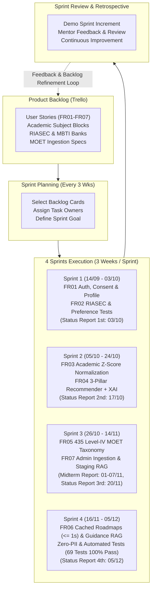

# CAPSTONE PROJECT PLAN
## AI CAREERGUIDE: Personalized Major Guidance for Vietnamese High School Students

**DUY TAN UNIVERSITY – INTERNATIONAL SCHOOL**  
**Course Code:** CMU-SE 450 – Capstone Project 1 (Group C1SE.71)  
**Academic Unit:** Faculty of Information Technology / International School  
**Document Version:** Version 1.1  
**Date:** November 04, 2026  
**Location:** Da Nang, Vietnam  

---

### **PROJECT INFORMATION**

| Field | Information | Field | Information |
| :--- | :--- | :--- | :--- |
| **Project Acronym** | AI CareerGuide | | |
| **Project Title** | AI CareerGuide: Personalized Major Guidance for Vietnamese High School Students | | |
| **Start Date** | 28 Jul 2026 | **End Date** | 26 Dec 2026 |
| **Lead Institution** | International School, Duy Tan University | | |
| **Project Mentor** | MSc. Son, Phan Van \| Email: sonpvs@duytan.edu.vn \| Tel: 0905042413 | | |
| **Scrum Master / Leader** | Duy, Nguyen Tan \| Email: nguyentduy.025@gmail.com \| Tel: 0396157802 | | |
| **Partner Organization** | Duy Tan University | | |
| **Project Web URL** | https://github.com/ntanduy25/AI-CAREERGUIDE | | |
| **Team Members (ID)** | **Name** | **Email** | **Tel / Role** |
| 29211142148 | Duy, Nguyen Tan | nguyentduy.025@gmail.com | 0396157802 (Scrum Master / Backend) |
| 29212736855 | Trung, Nguyen Tam | tamtrung3666@gmail.com | System Architect / Full-stack |
| 29214360592 | Cuong, Nguyen Tu | tucuong37k5@gmail.com | Product Owner / BA & QA |
| 29219030682 | Hieu, Nguyen Thai Hoang | nguyenthaihoanghieu3012005@gmail.com | Frontend / UI-UX |
| 29219065409 | Hien, Nguyen Thanh Long | hiennguyen05102005@gmail.com | AI, RAG & Data Engineer |
| **Document Title** | Project Plan | **Reporting Period** | September – December 2026 |
| **Date** | November 04, 2026 | **Filename** | C1SE.71_Project_Plan_ver1.1_AICareerGuide.docx |
| **Access** | Project Team and CMU Program | | |
| **Official Capstone Window** | 28 Jul 2026 – 26 Dec 2026 (Orientation to Defense) | | |
| **MVP Implementation Window** | 14 Sep 2026 – 12 Dec 2026 (4 Sprints Execution) | | |

---

### **DOCUMENT HISTORY**

| Version | Date | Comments |
| :--- | :--- | :--- |
| **1.0** | September 14, 2026 | Create initial Project Plan document aligned with Capstone 1 TimeLine. |
| **1.1** | November 04, 2026 | Update Project Plan: Align dates strictly with DTU Capstone TimeLine (14/09 – 12/12 Implementation, 17/12 – 26/12 Defense); organize 15 official Capstone deliverables; reflect technical baseline from Proposal v1.1 (Pure vocational guidance, 3-pillar XAI model, Solution B admission feasibility tiering, 435 Level-IV MOET majors, Two-Stream Ingestion with Qwen3-VL OCR and Tavily discovery, HITL staging review, and cached roadmaps with PostgreSQL JSONB + pgvector). |

---

### **DOCUMENT APPROVALS**

| Name & Role | Signature | Date |
| :--- | :--- | :--- |
| **MSc. Son, Phan Van** (Academic Mentor) | Approved | 14/09/2026 |
| **Duy, Nguyen Tan** (Scrum Master / Project Leader) | Signed | 14/09/2026 |
| **Cuong, Nguyen Tu** (Product Owner / BA & QA Lead) | Signed | 14/09/2026 |
| **Trung, Nguyen Tam** (System Architect) | Signed | 14/09/2026 |
| **Hieu, Nguyen Thai Hoang** (Frontend / UI-UX Lead) | Signed | 14/09/2026 |
| **Hien, Nguyen Thanh Long** (AI & Data Lead) | Signed | 14/09/2026 |

---

## **1. Introduction**

### **1.1. Purpose**
This document provides a comprehensive operational summary of the project's objectives, work breakdown, milestones, required resources, timeline, 4-Sprint development schedule, risk register, and budget allocation. It is strictly aligned with Proposal v1.1 and the official Duy Tan University Capstone 1 TimeLine (July 28 – December 26, 2026, with implementation running from September 14 to December 12, 2026). The project aims to build AI CareerGuide, a personalized major guidance and Explainable AI (XAI) decision-support platform for Vietnamese high school students (targeting Grades 11–12), delivering pure vocational guidance that evaluates student interests, cognitive learning styles, and standardized academic readiness across national admission subject combinations.

### **1.2. Project Overview**
Reference to Proposal v1.1 (AI CareerGuide: Personalized Major Guidance for Vietnamese High School Students).

High school students in Vietnam, particularly in Grades 11 and 12, stand before decisive crossroads determining their future academic and career pathways. Students frequently encounter severe career orientation challenges: lack of objective vocational guidance, fragmented career information, and external social pressures. Commercial personality testing platforms (such as online MBTI quizzes) yield archetype labels disconnected from Vietnamese higher education frameworks and Ministry of Education and Training (MOET) standards. Official university portals provide raw cutoff benchmarks without personalized diagnostic support. Crucially, many existing guidance systems enforce premature socio-economic filtering (filtering majors primarily by tuition cost and geographical region), which inadvertently discourages students from pursuing paths where they possess genuine talent, while completely ignoring national scholarships, tuition waivers, and financial aid.

To decisively resolve these issues, AI CareerGuide establishes a pure vocational guidance philosophy founded on validated theoretical pillars and engineering innovations:
1. **Vocational Interest Dimension:** Holland RIASEC Vocational Model & O*NET Interest Profiler standardizing intrinsic vocational interests into a 6-dimensional interest vector (Realistic, Investigative, Artistic, Social, Enterprising, Conventional).
2. **Academic Readiness Dimension:** Gardner's Multiple Intelligences Theory & Standardized Subject Combinations (A00, A01, B00, C00, D01) with national Z-score normalization to eliminate school-level grading variance.
3. **Cognitive Preference Dimension:** Jungian / MBTI-Inspired Cognitive Preference Framework mapping learning styles and problem-solving environments via deterministic trait-to-environment rules.
4. **Career Pathway & Skill Taxonomy:** Phoenix Ho Career Tree Model connecting roots (personality, values), trunk (435 official Level-IV university majors), and branches/leaves (career roles, emerging occupations, skill requirements).
5. **Explainable Recommendation Engine:** Deterministic 3-Pillar Weighted Hybrid Model ($0.45 \cdot S_{\text{RIASEC}} + 0.35 \cdot S_{\text{Academic}} + 0.20 \cdot S_{\text{Cognitive}}$) accompanied by Solution B dynamic academic clustering and admission feasibility tiering (High, Medium, Standard competition; Target vs. Reach).
6. **MOET Regulatory Ingestion:** Two-Stream Ingestion Pipeline with Stream A (MOET Circulars 09/2022 and 74/2026 ingested via Qwen3-VL multimodal vision OCR) and Stream B (Tavily Search API & Jina Reader for whitelisted web roadmap discovery) governed by a Human-in-the-Loop staging database.
7. **Grounded Retrieval-Augmented Generation:** Dual RAG System powered by PostgreSQL `pgvector` (Ingestion RAG for admin verification; Guidance RAG for personalized self-study tasks) with reusable roadmap caching indexed by `major_code` (retrieval $\le 1\text{s}$) and deterministic static fallback templates.

### **1.3. Project Deliverable**
The project serves two primary user roles and supporting educational stakeholders:
1. **High School Students (Grades 11-12):** Experience a guided, end-to-end pure vocational discovery workflow without socio-economic bias (tuition and geographical filters removed). Features include account registration, Law 91/2025/QH15 privacy consent, academic score input, Holland RIASEC & cognitive testing, explainable 3-pillar major recommendations with Solution B feasibility tiering (Target vs. Reach), 435 Level-IV MOET major browsing, and cached 4-week self-study roadmaps with exportable PDF reports.
2. **System Administrators:** Utilize a dedicated governance portal featuring Human-in-the-Loop (HITL) staging review. Administrators ingest official circulars via Qwen3-VL OCR, trigger whitelisted roadmap discovery via Tavily API, audit staged records, and publish verified content to the knowledge base without manual entry from scratch.

---

## **2. Team Organization**

### **2.1. Scrum Team Information**

**Table 1. Scrum Team Organization**

| Full Name | Phone | Email | Position |
| :--- | :--- | :--- | :--- |
| **MSc. Son, Phan Van** | 0905042413 | sonpvs@duytan.edu.vn | Academic Capstone Mentor |
| **Duy, Nguyen Tan** | 0396157802 | nguyentduy.025@gmail.com | Scrum Master / Backend Lead |
| **Cuong, Nguyen Tu** | 0914360592 | tucuong37k5@gmail.com | Product Owner / BA & QA Lead |
| **Trung, Nguyen Tam** | 0927368550 | tamtrung3666@gmail.com | System Architect / Full-Stack |
| **Hieu, Nguyen Thai Hoang** | 0919030682 | nguyenthaihoanghieu3012005@gmail.com | Frontend Developer / UI-UX Lead |
| **Hien, Nguyen Thanh Long** | 0919065409 | hiennguyen05102005@gmail.com | AI, RAG & Data Engineer |

---

### **2.2. Role and Responsibility**

**Table 2. Role and Responsibilities**

| Role | Responsibility | Name / Title |
| :--- | :--- | :--- |
| **Product Owner** | Understand Grade 11-12 student needs and pure career guidance goals; manage stakeholder expectations; prioritize Product Backlog on Trello; define user stories and acceptance criteria. | Cuong, Nguyen Tu |
| **Scrum Master** | Facilitate Scrum ceremonies; manage Sprint boards on Trello; remove impediments; maintain team focus on the 4-Sprint schedule; coordinate GitHub repo, CI/CD pipelines, and releases. | Duy, Nguyen Tan |
| **System Architect** | Design software architecture, PostgreSQL 16 + pgvector schema, asynchronous ORM migrations, security specifications, and micro-services boundary isolation. | Trung, Nguyen Tam |
| **Frontend Lead** | Design responsive UI/UX (Figma), implement React 18 + TypeScript SPA, ensure WCAG 2.1 AA accessibility, build interactive radar charts and guidance drawers. | Hieu, Nguyen Thai Hoang |
| **AI / Data Lead** | Implement 3-pillar XAI mathematical formulas, Solution B feasibility tiering, LlamaIndex Dual RAG, Tavily Search discovery, and Qwen3-VL OCR pipeline. | Hien, Nguyen Thanh Long |
| **Reviewer / QA** | Conduct peer code reviews, execute 69 automated Pytest test cases (100% pass), perform E2E Playwright tests, and audit Zero-PII sanitization compliance. | All Members (Lead: Cuong) |
| **Mentor** | Guide on software engineering processes; monitor project milestones; review architecture, AI ethics, and final deliverables. | MSc. Son, Phan Van |

---

### **2.3. Communication Methodology**

**Table 3. Communication Methodology**

| Audience / Attendees | Topic / Deliverable | Frequency | Method |
| :--- | :--- | :--- | :--- |
| **Mentor and Team Members** | Project Progress Review & Academic Guidance | Weekly | Face-to-face Meeting, Email, Zalo |
| **Team Members** | Daily Stand-up & Task Synchronization | Every two days | Trello, GitHub, Google Meet / Zoom |

---

### **2.4. Communication and Report**

**Table 4. Communication and Report**

| Type of Communication | Methods & Tools | Frequency | Information Exchanged | Attendees |
| :--- | :--- | :--- | :--- | :--- |
| **Scrum Stand-up** | Face-to-face / Meet | Every 2 days (15 min) | Status of past 48h, daily goals, blockers and solutions. | Project team |
| **Sprint Planning** | Face-to-face Meeting | Start of each Sprint | Analyze user stories, break down backlog cards, assign Trello tasks. | Project team |
| **Sprint Review & Retrospective** | Meeting with Mentor | End of each Sprint | Demo sprint increment, mentor review, evaluate strengths/weaknesses. | Team & Mentor |
| **Bi-weekly Status Reports** | Formal Written Report | Bi-weekly (4 Reports) | Submit official status reports per university timeline (Report 1–4). | Team & Mentor |

---

## **3. Development Process**

Scrum is an agile framework that follows an iterative and incremental approach to software development, focusing on managing projects and developing products or applications. For AI CareerGuide, the development phase is structured into 4 disciplined Sprints running within the official implementation window (September 14 – December 12, 2026), managed transparently via Trello boards and GitHub releases. Scrum relies on empirical process control, using continuous feedback loops as its core management strategy, empowering the engineering team to adapt to uncertainties, refine software modules, and validate AI recommendation accuracy in close alignment with academic mentor feedback.

*Figure 1. Scrum Process for AI CareerGuide Platform (4-Sprint Lifecycle)*

---

## **4. Schedule and Cost**

### **4.1. Detailed Schedule (Aligned with DTU Capstone TimeLine)**

The project schedule spans the complete academic Capstone 1 timeframe (July 28 – December 26, 2026), strictly adhering to the official Duy Tan University TimeLine:
- **Capstone Inception & Requirements (28/07 – 12/09/2026):** Orientation, mentor assignment, proposal preparation, proposal submission (05/09), and project approval.
- **Sprint 1 (14/09 – 03/10/2026):** Setup, Project Plan submission (14/09), Architecture docs (18/09), DB design docs (25/09), FR01 Identity & Law 91/2025 Consent, Argon2id, Google OAuth, FR02 RIASEC & Preference Assessments, and Status Report 1st (03/10).
- **Sprint 2 (05/10 – 24/10/2026):** FR03 Academic Grade Entry & National Z-Score Normalization (Gaussian CDF), FR04 Deterministic 3-Pillar XAI Recommender & Solution B Feasibility Tiering, and Status Report 2nd (17/10).
- **Sprint 3 (26/10 – 14/11/2026):** Midterm Report (01/11 – 07/11), FR05 435 Level-IV MOET Major Taxonomy & Career Tree Exploration, FR07 Admin Two-Stream Ingestion (Qwen3-VL OCR & Tavily) with Human-in-the-Loop staging review, and Status Report 3rd (20/11).
- **Sprint 4 (16/11 – 05/12/2026):** FR06 Cached 4-Week Study Roadmaps (JSONB + pgvector $\le 1\text{s}$), Guidance RAG Personalization, Zero-PII Regex Sanitizer, Static Fallback Templates, Usability Testing, 69 Pytest test suite, and Status Report 4th (05/12).
- **Final Polish & Defense (06/12 – 26/12/2026):** Final Implementation Closure (12/12), Final Submission Window (10/12 – 13/12), and Capstone Defense (17/12 – 26/12).

**Table 5. Detailed Schedule (Strictly Aligned with Official DTU Capstone TimeLine)**

| No. | Task Name & Deliverables | Start | Finish | Effort |
| :--- | :--- | :--- | :--- | :--- |
| **1** | **Capstone Inception & Requirements** | **28/07** | **12/09** | **120 hrs** |
| 1.1 | Capstone Orientation 1 (MIS-SE-NE Group Unit CMU) | 28/07 | 07/08 | 16 hrs |
| 1.2 | Team Selection & Formation (Group C1SE.71) | 01/08 | 14/08 | 12 hrs |
| 1.3 | Capstone Orientation 2 & Guidelines | 09/08 | 14/08 | 8 hrs |
| 1.4 | Academic Mentor Assignment (MSc. Son, Phan Van) | 10/08 | 16/08 | 4 hrs |
| 1.5 | Proposal Preparation & Theoretical Framework Mapping | 16/08 | 22/08 | 25 hrs |
| 1.5.1 | Analyze high school guidance needs & theoretical models (RIASEC, Gardner, MBTI) | 16/08 | 19/08 | 15 hrs |
| 1.5.2 | Define pure vocational guidance scope (exclude tuition & location bias) | 20/08 | 22/08 | 10 hrs |
| 1.6 | Draft and Finalize Proposal Document (v1.0 – v1.1) | 24/08 | 04/09 | 35 hrs |
| 1.6.1 | Formulate 3-pillar XAI mathematical formulas & Solution B feasibility clustering | 24/08 | 28/08 | 15 hrs |
| 1.6.2 | Design Two-Stream Ingestion Architecture (Qwen3-VL OCR & Tavily) + Dual RAG | 29/08 | 02/09 | 12 hrs |
| 1.6.3 | Proposal Review with Academic Mentor | 03/09 | 04/09 | 8 hrs |
| 1.7 | Submit Proposal Document to CMU Committee (Milestone: 24/08 – 05/09) | 05/09 | 05/09 | 4 hrs |
| 1.8 | Present Proposal & Project Approval by Faculty Committee | 05/09 | 12/09 | 16 hrs |
| **2** | **Project Setup & Baseline Deliverables** | **14/09** | **25/09** | **45 hrs** |
| 2.1 | Workspace Setup: GitHub Repository, Docker, Trello Scrum Board | 14/09 | 14/09 | 5 hrs |
| 2.2 | Submit Master Project Plan (Milestone per Timeline: 07/09 – 14/09) | 14/09 | 14/09 | 6 hrs |
| 2.3 | Architecture Modeling & Submit Architecture Documents (Milestone: 14/09 – 18/09) | 14/09 | 18/09 | 16 hrs |
| 2.3.1 | Define 3-Tier Modular Monolith services & boundary isolation matrix | 14/09 | 16/09 | 8 hrs |
| 2.3.2 | Finalize ADD Document and submit to CMU Committee | 17/09 | 18/09 | 8 hrs |
| 2.4 | Database Modeling & Submit DB Design Docs (Milestone: 21/09 – 25/09) | 21/09 | 25/09 | 18 hrs |
| 2.4.1 | Design PostgreSQL 16 schema (JSONB roadmap structures & pgvector 1536-dim tables) | 21/09 | 23/09 | 10 hrs |
| 2.4.2 | Finalize DB Design Document and verify Alembic async migration scripts | 24/09 | 25/09 | 8 hrs |
| **3** | **Development Phase (4 Disciplined Sprints: 14/09 – 12/12/2026)** | **14/09** | **12/12** | **380 hrs** |
| **3.1** | **Sprint 1: FR01 Identity & Consent + FR02 RIASEC & Preference Assessments** | **14/09** | **03/10** | **95 hrs** |
| 3.1.1 | Sprint 1 Planning Meeting & Trello Backlog Setup | 14/09 | 15/09 | 4 hrs |
| 3.1.2 | Design UI/UX for Landing Page, Auth & Assessment Wizards (WCAG 2.1 AA) | 16/09 | 20/09 | 16 hrs |
| 3.1.3 | Code Backend Identity Service (Argon2id password hashing, JWT, Google OAuth 2.0) | 21/09 | 24/09 | 16 hrs |
| 3.1.4 | Code Law 91/2025/QH15 Privacy Consent & Student Profile Management API | 25/09 | 27/09 | 12 hrs |
| 3.1.5 | Code Frontend Auth Forms, Google Sign-In button & Profile Wizard | 25/09 | 28/09 | 12 hrs |
| 3.1.6 | Code Versioned Question Bank API (30 RIASEC items & 12 cognitive traits) | 28/09 | 30/09 | 12 hrs |
| 3.1.7 | Code Interactive Questionnaire Flow with Auto-Save & Radar Chart (UI) | 29/09 | 01/10 | 12 hrs |
| 3.1.8 | Unit & Integration Testing (Pytest auth, consent logs & RIASEC scoring math) | 01/10 | 02/10 | 8 hrs |
| 3.1.9 | Submit Status Report 1st (Milestone per Timeline: 28/09 – 03/10) | 03/10 | 03/10 | 3 hrs |
| **3.2** | **Sprint 2: FR03 Academic Z-Score Normalization + FR04 3-Pillar Recommender** | **05/10** | **24/10** | **100 hrs** |
| 3.2.1 | Sprint 2 Planning Meeting & Trello Backlog Grooming | 05/10 | 05/10 | 3 hrs |
| 3.2.2 | Design UI/UX for Academic Grade Input & Top-5 Recommended Majors Dashboard | 06/10 | 09/10 | 14 hrs |
| 3.2.3 | Code Multi-Semester Academic Grade Entry API & Validation Rules | 10/10 | 13/10 | 14 hrs |
| 3.2.4 | Submit Status Report 2nd (Milestone per Timeline: 12/10 – 17/10) | 17/10 | 17/10 | 3 hrs |
| 3.2.5 | Code National Z-Score Normalization Engine & Gaussian Normal CDF Φ(Z) | 14/10 | 17/10 | 14 hrs |
| 3.2.6 | Code RIASEC Cosine Similarity & Deterministic Cognitive Trait Matchers | 18/10 | 20/10 | 14 hrs |
| 3.2.7 | Code 3-Pillar Hybrid Model (0.45 RIASEC + 0.35 Academic + 0.20 Pref) | 20/10 | 22/10 | 14 hrs |
| 3.2.8 | Code Solution B Dynamic Academic Clustering & Admission Feasibility (Target/Reach) | 21/10 | 23/10 | 12 hrs |
| 3.2.9 | Test 3-Pillar Scoring & Feasibility Logic on 30 Synthetic Student Profiles | 23/10 | 24/10 | 8 hrs |
| 3.2.10 | Sprint 2 Review & Retrospective Meeting | 24/10 | 24/10 | 4 hrs |
| **3.3** | **Sprint 3: FR05 MOET Taxonomy & FR07 Two-Stream Ingestion with HITL** | **26/10** | **14/11** | **95 hrs** |
| 3.3.1 | Sprint 3 Planning Meeting & Trello Backlog Cards | 26/10 | 26/10 | 3 hrs |
| 3.3.2 | Prepare Midterm Report & Documentation (Milestone: 01/11 – 07/11) | 27/10 | 02/11 | 16 hrs |
| 3.3.3 | Faculty Midterm Defense & Progress Evaluation Review | 03/11 | 07/11 | 8 hrs |
| 3.3.4 | Ingest and Normalize 435 Level-IV MOET Majors across 22 Disciplines (TT09 & TT74) | 05/11 | 08/11 | 16 hrs |
| 3.3.5 | Implement Stream A: Qwen3-VL Vision OCR & Regex Parser for Circular PDFs | 08/11 | 10/11 | 14 hrs |
| 3.3.6 | Implement Stream B: Whitelisted Web Discovery via Tavily API & Jina Reader | 10/11 | 12/11 | 14 hrs |
| 3.3.7 | Build Human-in-the-Loop (HITL) Staging Review UI for Administrators | 11/11 | 13/11 | 14 hrs |
| 3.3.8 | Sprint 3 Testing, Review & Retrospective | 14/11 | 14/11 | 6 hrs |
| **3.4** | **Sprint 4: FR06 Cached Roadmaps, Dual RAG, Security Audit & E2E Testing** | **16/11** | **05/12** | **90 hrs** |
| 3.4.1 | Sprint 4 Planning Meeting & Trello Backlog Assignment | 16/11 | 16/11 | 3 hrs |
| 3.4.2 | Submit Status Report 3rd (Milestone per Timeline: 16/11 – 20/11) | 20/11 | 20/11 | 3 hrs |
| 3.4.3 | Implement Write-Once/Read-Many Roadmap Caching in PostgreSQL (JSONB + pgvector ≤ 1s) | 17/11 | 21/11 | 16 hrs |
| 3.4.4 | Build Guidance RAG Personalization Engine with Deterministic Fallback Templates | 21/11 | 25/11 | 16 hrs |
| 3.4.5 | Implement Zero-PII Regex Sanitizer (Law 91/2025/QH15) & Security Hardening | 25/11 | 27/11 | 10 hrs |
| 3.4.6 | Conduct Usability Pilot Evaluation with ≥ 20 High School Students | 27/11 | 01/12 | 14 hrs |
| 3.4.7 | Execute Automated Pytest Suite (69 test cases, 100% PASS) & Playwright E2E | 01/12 | 04/12 | 12 hrs |
| 3.4.8 | Submit Status Report 4th (Milestone per Timeline: 29/11 – 05/12) | 05/12 | 05/12 | 3 hrs |
| 3.4.9 | Sprint 4 Review & Sprint Retrospective Meeting | 05/12 | 05/12 | 3 hrs |
| **3.5** | **Implementation Closure & Cloud Deployment Verification** | **06/12** | **12/12** | **20 hrs** |
| 3.5.1 | Deploy Frontend on Vercel & Backend REST API on Render with PostgreSQL | 06/12 | 08/12 | 10 hrs |
| 3.5.2 | Conduct End-to-End Smoke Tests, Performance Tuning & Code Freeze | 09/12 | 11/12 | 6 hrs |
| 3.5.3 | Official Implementation Window Closes (Milestone: 12/12/2026) | 12/12 | 12/12 | 4 hrs |
| **4** | **Final Delivery & Capstone Defense Phase** | **10/12** | **26/12** | **60 hrs** |
| 4.1 | Compile and Package 15 Official Capstone Deliverable Folders | 10/12 | 12/12 | 20 hrs |
| 4.2 | Final Submission Window (Milestone per Timeline: 10/12 – 13/12/2026) | 13/12 | 13/12 | 6 hrs |
| 4.3 | Prepare Defense Presentation Slides, Demonstration Media & Rehearsal | 14/12 | 16/12 | 16 hrs |
| 4.4 | Formal Capstone 1 Defense Committee Evaluation (Milestone: 17/12 – 26/12/2026) | 17/12 | 26/12 | 18 hrs |

---

### **4.2. Cost Estimation**

#### **4.2.1. Cost Person/Hours**

**Table 6. Cost Person/Hours**

| Full Name | Role | Salary Rate (USD/hour) |
| :--- | :--- | :--- |
| **Duy, Nguyen Tan** | Scrum Master / Project Leader | 2 |
| **Cuong, Nguyen Tu** | Product Owner / BA & QA Lead | 2 |
| **Trung, Nguyen Tam** | System Architect / Full-stack | 2 |
| **Hieu, Nguyen Thai Hoang** | Frontend / UI-UX Lead | 2 |
| **Hien, Nguyen Thanh Long** | AI, RAG & Data Engineer | 2 |

#### **4.2.2. Total Cost Estimate**

**Table 7. Total Cost Estimation**

| No. | Cost Criteria | Unit Rate | Total (USD) |
| :--- | :--- | :--- | :--- |
| 1 | Labor Working Hours (1,350 total engineering hours) | 2 | 2,700 |
| 2 | Operational & Cloud Infrastructure Cost | 100 | 500 |
| | **Total Project Budget** | | **3,200** |

**Table 8. Cost Description**

| Description | Amount | Unit |
| :--- | :--- | :--- |
| **Number of members** | 5 | Person |
| **Number of working hours per day** | 3 | Hours |
| **Cost per hour per member** | 2 | USD |
| **Number of working days in implementation window** | 90 | Days (14/09 – 12/12/2026) |

*Detailed budget calculation explanation:*
- **Labor Cost:** 5 members $\times$ 3 hours/day $\times$ 90 working days = 1,350 total hours $\times$ \$2/hour = **2,700 USD**.
- **Operational & Infrastructure Cost:** 5 members $\times$ 100 USD = **500 USD** (Allocated for cloud infrastructure hosting on Render/Vercel, managed PostgreSQL 16 with `pgvector`, OpenAI / DeepSeek token usage quotas, Tavily Search API subscriptions, and local staging servers).
- **Comprehensive Project Budget:** 2,700 USD (Labor) + 500 USD (Operational) = **3,200 USD**.

---

## **5. Project Risk**

**Table 9. Rating for Likelihood and Seriousness for Each Risk**

| Code | Likelihood Scale | Code | Seriousness Scale |
| :--- | :--- | :--- | :--- |
| **L** | Rated as Low | **E** | Rated as Extreme (Used for Seriousness only) |
| **M** | Rated as Medium | **NA** | Not Assessed |
| **H** | Rated as High | | |

**Table 10. Project Risk Register and Mitigation Strategies**

| Risk Domain | Risk Definition | Level | Likelihood | Mitigation Strategy |
| :--- | :--- | :--- | :--- | :--- |
| **MOET PDF Document Parsing Errors** | Official MOET circulars in PDF format may contain complex scanned tables or formatting irregularities during automated extraction. | H | H | Enforce the Human-in-the-Loop staging workflow (`PENDING` status) with Qwen3-VL OCR and Ingestion RAG page citations so administrators inspect, edit, and approve all records before publishing. |
| **LLM Generative Hallucination** | External LLMs could invent non-existent majors or inaccurate admission advice if left unconstrained. | E | M | Strictly isolate LLMs from the 3-pillar ranking calculation (100% deterministic math); ground all study guidance in verified PostgreSQL `pgvector` documents via Guidance RAG with deterministic template fallback. |
| **Recommendation Weight & Alignment Bias** | Initial 3-pillar weights or Z-score baselines may produce unstable rankings for edge-case profiles. | H | M | Validate scoring across 30+ synthetic and consented profiles; conduct sensitivity analysis, mentor rubric evaluation, and support versioned administrative weight tuning. |
| **Privacy & Minor Data Protection** | Handling academic grades and psychological preference indicators of minors involves strict legal compliance under Law No. 91/2025/QH15. | E | L | Apply data minimization, explicit consent logging, RBAC, Argon2id hashing, and zero PII transmission to external LLM APIs via regex sanitization. |
| **Unlicensed Instrument Misrepresentation** | Presenting an informal preference test as the official commercial MBTI instrument violates licensing guidelines. | H | L | Label the preference module clearly as an educational Jungian/MBTI-inspired learning-style indicator with explicit limitation disclaimers. |
| **Estimated Schedule Across 4 Sprints** | Delivering FastAPI, React, 3-pillar math, semi-automated ingestion, and Dual RAG within 4 Sprints requires tight coordination. | H | M | Enforce strict MVP boundaries (no mobile apps, no live web scrapers, no tuition/location filters); track and update tasks daily on Trello. |
| **External API Latency or Outage** | Embedding or LLM API calls may experience slow response times (>8s) or quota exhaustion during live demonstrations. | M | M | Implement strict 8-second timeouts, usage caps, write-once/read-many caching in PostgreSQL, and automatic fallback to deterministic explanation templates. |
| **Project Management on Trello** | Trello cards may become outdated if members forget to update task statuses or checklists. | L | M | Scrum Master reviews the Trello board every two days during Stand-up meetings to ensure accurate status tracking. |

---

## **6. Deliverables (15 Official Capstone Deliverables)**

All project documentation and software engineering artifacts are organized strictly according to the official Capstone Documentation repository structure (comprising 15 standardized project folders shown in Figure 2), with deadlines strictly aligned with the DTU Capstone 1 TimeLine:

**Table 11. Deliverables (Aligned with 15 Official Capstone Project Folders & DTU TimeLine)**

| No. | Deliverable Document Name | Deadline | Target Folder Name | Scope & Description |
| :--- | :--- | :--- | :--- | :--- |
| **01** | Final Capstone Report & Presentation Package | 13/12/2026 | `01_Final_Report` | Comprehensive Final Capstone Project Report, Summary Brief, and Defense Slide Deck. |
| **02** | Project Proposal Document (v1.0 & v1.1) | 05/09/2026 | `02_Project_Proposal` | Approved Capstone Proposal defining pure guidance scope, 3-pillar math, and theoretical grounding. |
| **03** | Project & Sprint Plan Document (v1.0 & v1.1) | 14/09/2026 | `03_Project_and_Sprint_Plan` | Master 4-Sprint Project Plan with WBS, resource budget, and Trello backlog mappings. |
| **04** | Software Requirements Specification (SRS) | 03/10/2026 | `04_Requirements_Engineering_SRS` | Detailed functional requirements (FR01-FR07), non-functional requirements (NFR01-NFR06), and use cases. |
| **05** | Architecture & Database Design Document | 25/09/2026 | `05_System_Architecture_and_DB_Design` | 3-Tier Modular Monolith architecture, PostgreSQL 16 + `pgvector` schema, and Dual RAG data flows (ADD 18/09, DB 25/09). |
| **06** | UI/UX Design Package & Design System | 28/09/2026 | `06_UI_Design` | Figma wireframes, WCAG 2.1 AA responsive layouts, component specifications, and radar charts. |
| **07** | Software Test Plan (Master QA Strategy) | 10/10/2026 | `07_Software_Test_Plan` | Master test strategy covering unit tests, API tests, E2E flows, security checks, and pilot evaluation rubrics. |
| **08** | Test Cases, Data & Synthetic Profiles | 24/10/2026 | `08_Test_Cases_and_Data` | Comprehensive test case catalog, national Z-score benchmarks, and 30 synthetic student profile datasets. |
| **09** | Test Execution & Bug Reports | 05/12/2026 | `09_Test_and_Bug_Reports` | Automated Pytest suite execution logs (69 test cases, 100% PASS), Playwright reports, and bug traceability matrices. |
| **10** | Meeting Minutes & Teamwork Evidence | 10/12/2026 | `10_Meeting_Minutes_and_Teamwork_Evidence` | Records of all mentor progress meetings, bi-weekly status reports (1st–4th), stand-up logs, and Trello board snapshots. |
| **11** | Code & Project Standards Specification | 18/09/2026 | `11_Code_and_Project_Standards` | Coding conventions (PEP 8, TypeScript strict), OWASP ASVS Level 2 security guidelines, and Git branch/commit workflows. |
| **12** | Reflection & Peer Evaluation Package | 10/12/2026 | `12_Reflection_and_Peer_Evaluation` | Individual technical reflection reports, contribution matrices, and team peer evaluation assessments. |
| **13** | Technical Deep-Dive Report | 05/12/2026 | `13_Technical_Report` | In-depth engineering report on 3-Pillar XAI formulation, Solution B academic clustering, Qwen3-VL OCR, and Dual RAG orchestration. |
| **14** | Complete Source Code Repository | 13/12/2026 | `14_Source_Code` | Clean Git repository containing React 18 SPA frontend, FastAPI backend, Docker Compose setup, and Alembic database migrations. |
| **15** | Revised Documents & Defense Presentation Package | 13/12/2026 | `15_Revised_Documents_and_Slides` | Final revised documentation package, demonstration video script, and high-resolution slides for Capstone Defense. |

---

## **7. References**

1. National Center for O*NET Development, *"O*NET Interest Profiler,"* O*NET Resource Center, 2026. [Online]. Available: https://www.onetcenter.org/IP.html
2. J. L. Holland, *"Making Vocational Choices: A Theory of Vocational Personalities and Work Environments,"* 3rd ed., Psychological Assessment Resources, Odessa, FL, 1997.
3. H. Gardner, *"Frames of Mind: The Theory of Multiple Intelligences,"* Basic Books, New York, 1983.
4. Phoenix Ho, *"Dung Ngoi Cho Co Hoi Den (Career Tree Guidance Framework),"* Tre Publishing House, Ho Chi Minh City, 2020.
5. Ministry of Education and Training of Vietnam, *"Circular 09/2022/TT-BGDĐT: Regulations on the List of Higher Education Training Programs,"* MOET, Hanoi, 2022.
6. Ministry of Education and Training of Vietnam, *"Circular 74/2026/TT-BGDĐT: Promulgating the List of Level-IV Higher Education Training Programs,"* MOET, Hanoi, 2026.
7. National Assembly of Vietnam, *"Law No. 91/2025/QH15 on Personal Data Protection,"* Hanoi, 2025.
8. Government of Vietnam, *"Decree No. 13/2023/NĐ-CP on Personal Data Protection,"* Hanoi, 2023.
9. OWASP Foundation, *"Application Security Verification Standard (ASVS), Version 5.0,"* OWASP, 2025. [Online]. Available: https://owasp.org/www-project-application-security-verification-standard/
10. ISO/IEC 25010:2023, *"Systems and Software Engineering – Systems and Software Quality Requirements and Evaluation (SQuaRE) – Product Quality Model,"* ISO, 2023.
11. K. Schwaber and J. Sutherland, *"The Scrum Guide,"* Scrum.org, 2020. [Online]. Available: https://scrumguides.org/docs/scrumguide/v2020/2020-Scrum-Guide-US.pdf
12. E. A. Locke and G. P. Latham, *"Building a Practically Useful Theory of Goal Setting and Task Motivation,"* American Psychologist, vol. 57, no. 9, pp. 705–717, 2002.
13. P. Lewis et al., *"Retrieval-Augmented Generation for Knowledge-Intensive NLP Tasks,"* Advances in Neural Information Processing Systems (NeurIPS), 2020.
14. PostgreSQL Global Development Group, *"pgvector: Open-source Vector Similarity Search for PostgreSQL,"* 2026. [Online]. Available: https://github.com/pgvector/pgvector
15. J. Liu, *"LlamaIndex: Data Framework for LLM Applications,"* 2026. [Online]. Available: https://www.llamaindex.ai/
